# win31ui

> **A pixel-perfect Windows 3.1 React component library** — 34 components, six colour themes, a working Program Manager desktop replica, SSR-safe, ready for the web, Next.js, Electron and Tauri.

[](https://www.npmjs.com/package/@win31ui/react)
[](https://www.npmjs.com/package/@win31ui/react)
[](./LICENSE)
[](https://react.dev)

**[Live demo](https://shinetaku.github.io/win31ui/)** · [中文文档](./README.zh-CN.md) · AI coding guide: [AGENTS.md](./AGENTS.md) / [中文](./AGENTS.zh-CN.md)

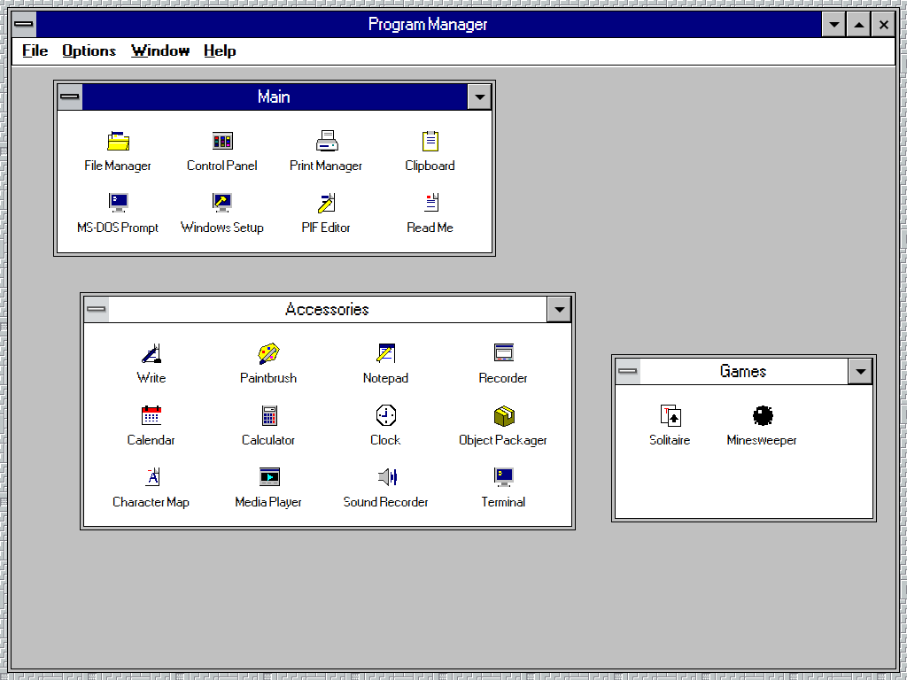

A complete replica of the Windows 3.1 **Program Manager** desktop built entirely
from this library: program groups, 22 working applications, draggable windows,
menus, dialogs and six switchable colour schemes — all in ~1,900 lines of React.

## Live demo

**https://shinetaku.github.io/win31ui/** — deployed automatically from
`examples/desktop-demo` on every push to `main` via GitHub Pages.

## Watch it move

| Windows & drag | File Manager |
|---|---|
|  | 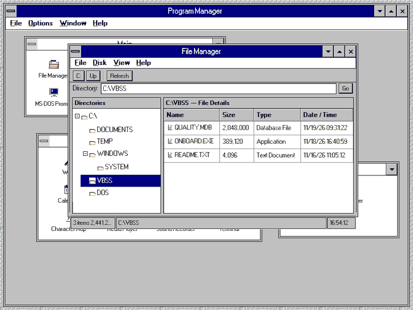 |

| Calculator | Colour schemes (six themes) |
|---|---|
| 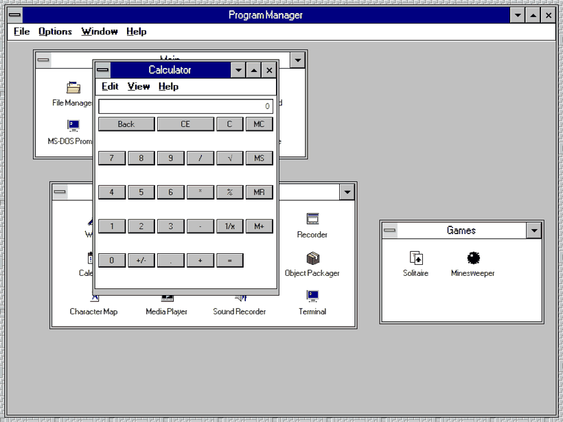 | 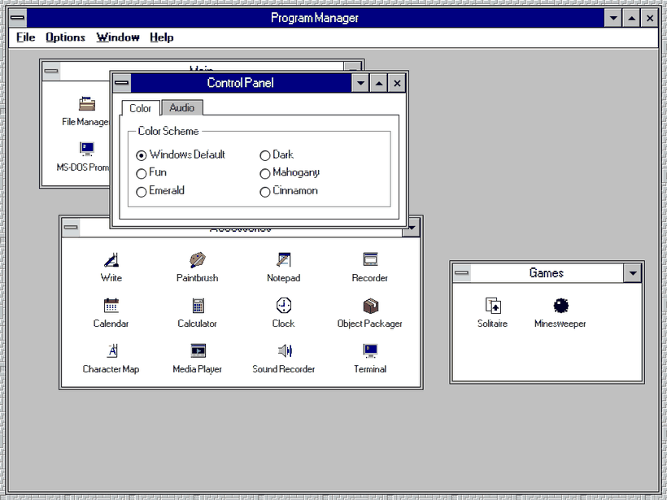 |

| Minesweeper |
|---|
| 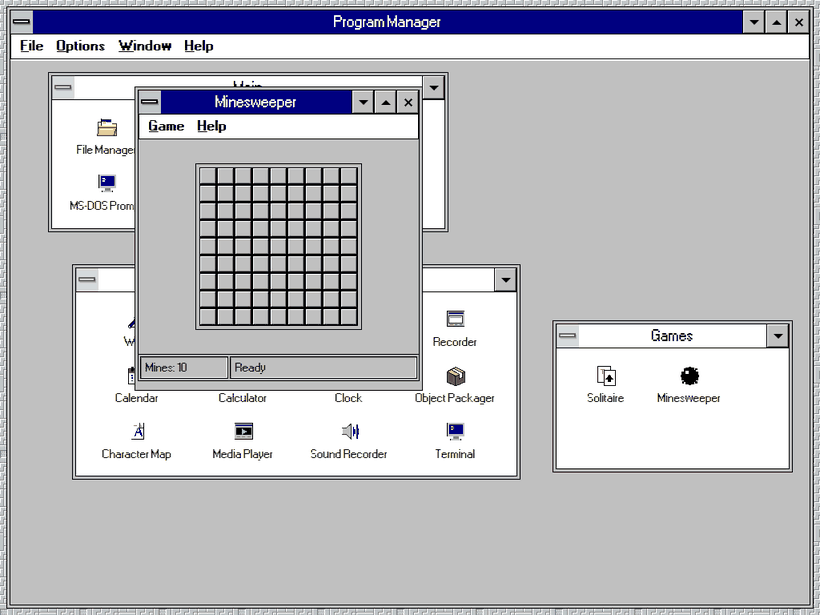 |

## Screens

| | |
|---|---|
|  | 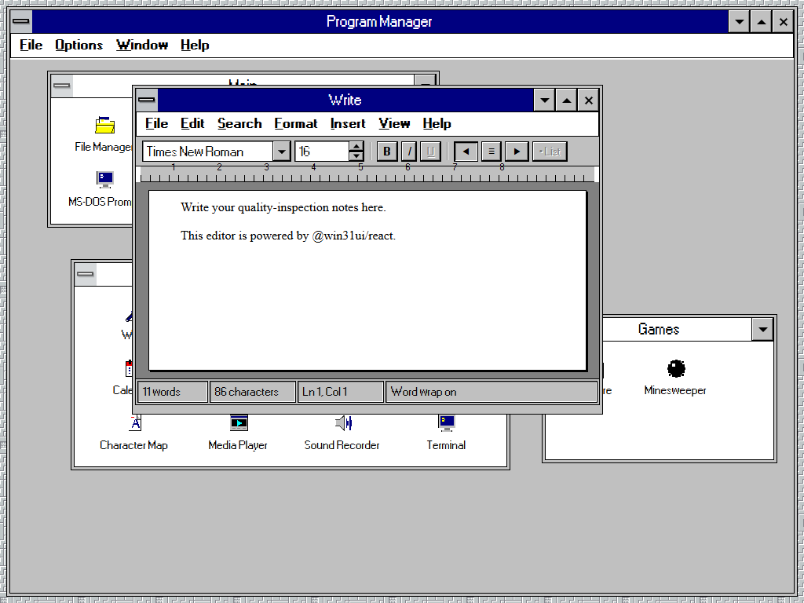 |
| 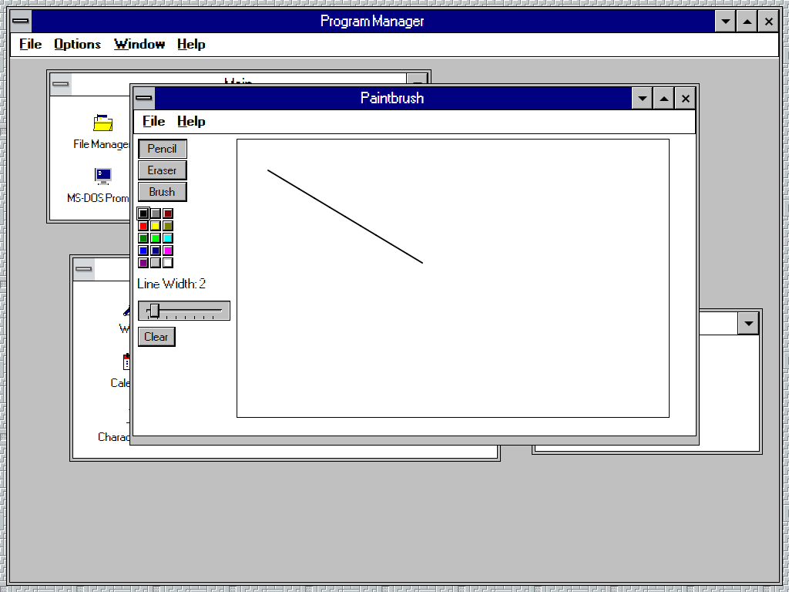 | 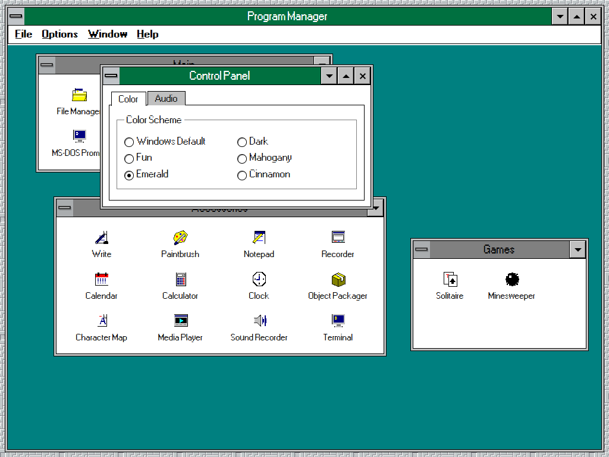 |
| 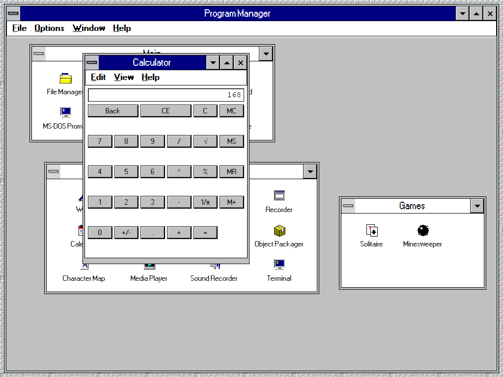 | 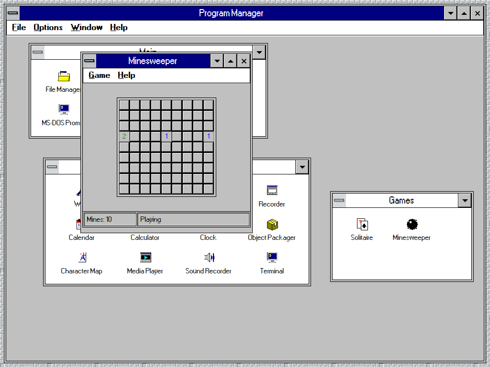 |
| 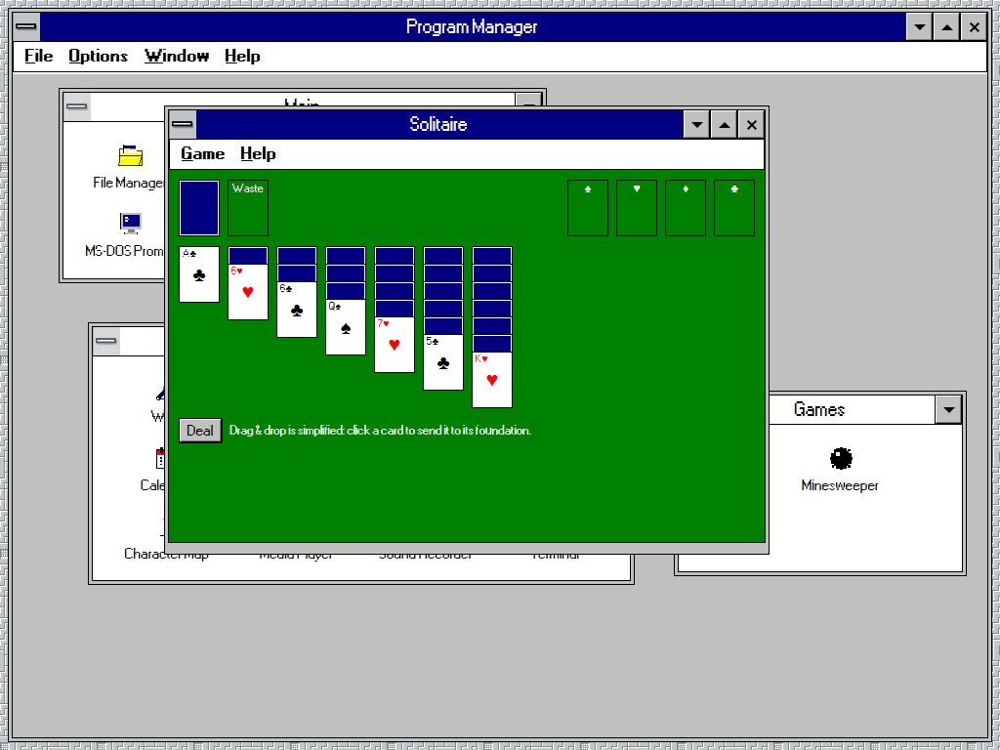 | 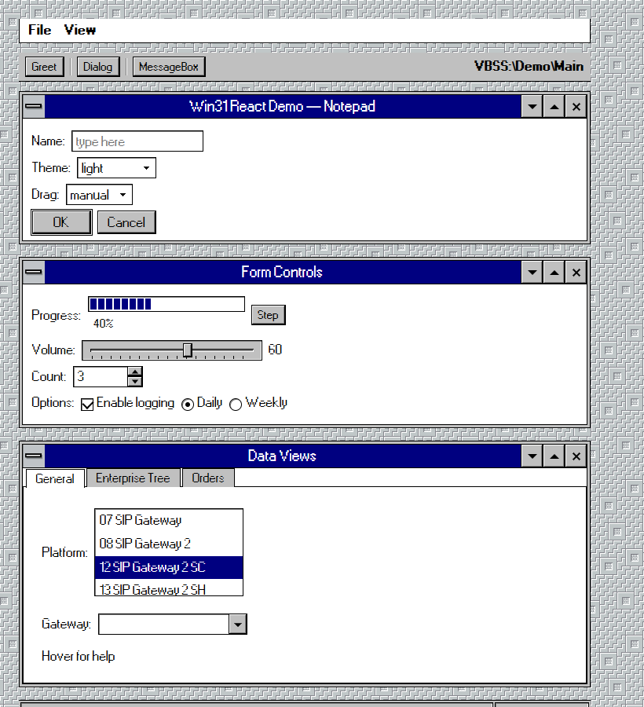 |

## Highlights

- **Authentic 3.1 look** — 16-colour palette, 1px black borders with 2px
  bevels, #000080 title bars, MS Sans Serif pixel font, no rounded corners,
  shadows or gradients (design tokens extracted from
  [hugo-win31](https://github.com/theletterf/hugo-win31), MIT).
- **Six themes** — switch the whole desktop live: `light` (Windows Default),
  `dark`, `fun`, `mahogany`, `emerald`, `cinnamon`.
- **Accessible** — ARIA menubar keyboard model (single tab stop, arrow keys),
  sortable table header buttons with `aria-sort`, native `<dialog>` modals,
  keyboard-driven slider/number/tree/list widgets.
- **SSR & desktop ready** — server-renderable components, `'use client'` entry,
  four window drag modes (`none` / `manual` / `electron` / `tauri`).
- **One dependency** — styles, pixel font and bitmap assets ship inside
  `@win31ui/react`.

## Install

```bash
npm install @win31ui/react
```

```ts
import '@win31ui/react/win31.css'   // tokens, themes, fonts, base classes
import '@win31ui/react/styles.css'  // component states
import { Win31Window, Win31Button, Win31MenuBar } from '@win31ui/react'
```

```tsx
<Win31Window title="Quality inspection" dragMode="manual" bodyClassName="is-flush">
  <Win31MenuBar>{/* Win31Menu … */}</Win31MenuBar>
  <Win31Field label="Enterprise:"><Win31Input placeholder="ACME" /></Win31Field>
  <Win31Button isDefault>OK</Win31Button>
</Win31Window>
```

Bitmap assets are available under `@win31ui/react/assets/*`.

## Components

| Group | Components |
|---|---|
| Theme | `Win31Provider`, `useWin31Theme`, `applyWin31Theme` — `data-win31-theme` on `<html>` |
| Window | `Win31Window` (dialog/maximized states), `Win31TitleBar` (system menu, min/max/close, four `dragMode`s) |
| Menus | `Win31MenuBar` (single tab stop, arrow navigation, hover switching), `Win31Menu`, `Win31MenuItem`, `Win31MenuLink`, `Win31MenuSeparator` |
| Navigation | `Win31Tabs` (ARIA tablist), `Win31GroupBox` |
| Controls | `Win31Button`, `Win31Input`, `Win31Textarea`, `Win31Field`, `Win31Checkbox`, `Win31Radio`, `Win31NumberField`, `Win31Slider`, `Win31ProgressBar`, `Win31ComboBox`, `Win31ListBox` |
| Data | `Win31Table<T>` (TanStack: sortable header buttons, row selection), `Win31Tree` (boxed ± carets, custom icons), `Win31List` (detail list with group/indent rows), `Win31Calendar` |
| Feedback | `Win31Dialog` (native `<dialog>`), `Win31MessageBox`, `Win31Tooltip` |
| Bars | `Win31Toolbar`, `Win31ToolbarSeparator`, `Win31StatusBar`, `Win31StatusPane` |
| Desktop | `Win31Desktop`, `Win31DesktopIcon` |

Every props type is exported; hover any component in your editor for JSDoc.

## SSR (Next.js App Router)

```tsx
// app/layout.tsx
export default function RootLayout({ children }: { children: React.ReactNode }) {
  return (
    <html lang="en" data-win31-theme="light">
      <body>{children}</body>
    </html>
  )
}
```

See [`examples/next-app`](./examples/next-app) — it asserts SSR markup and a
zero-error hydration in its Playwright suite.

## Electron / Tauri

Pass `dragMode="electron"` (`-webkit-app-region: drag`) or
`dragMode="tauri"` (`data-tauri-drag-region`) on `Win31Window` /
`Win31TitleBar`. The Vite demo doubles as the shared renderer — see
[desktop.md](./examples/vite-app/desktop.md) / [中文](./examples/vite-app/desktop.zh-CN.md).

## Repository structure

```
packages/win31-tokens/   design tokens, themes, fonts, bitmaps (not published)
packages/win31-react/    the published library — components + bundled tokens
examples/desktop-demo/   Windows 3.1 Program Manager replica (live demo)
examples/vite-app/       component gallery + Electron/Tauri renderer
examples/next-app/       SSR proof (App Router)
e2e/                     Playwright suites for all three demos
docs/screenshots/        README assets
scripts/                 screenshot/GIF generator, interactive self-test
```

## Development

```bash
npm install          # workspaces (bun install has a Windows EPERM bug here)
npm run build        # build @win31ui/react (esm + cjs + d.ts + tokens)
npm run typecheck    # strict tsc across packages
npm test             # 125 vitest unit tests (jsdom)
npm run dev:desktop  # desktop replica on :5174
npm run dev:vite     # component gallery on :5173
npm run dev:next     # SSR demo on :3000
```

## Testing

- **Unit** — vitest + Testing Library, 125 tests across 21 spec files
- **E2E** — Playwright on system Edge against all demos:
  `npm run test:e2e:vite` (14), `npm run test:e2e:next` (8),
  `npm run test:e2e:desktop` (15), including SSR markup checks,
  hydration-error scans and visual snapshots
- **Interactive self-test** — `python scripts/selftest.py` drives 20 real
  user journeys through the desktop demo

## Attribution

- Design language and pixel assets: [theletterf/hugo-win31](https://github.com/theletterf/hugo-win31) (MIT)
- 32×16-colour application glyphs: adapted from [WieslawSoltes/Win31](https://github.com/WieslawSoltes/Win31) (MIT)

## License

MIT — see [LICENSE](./LICENSE).
