# win31ui

> **高保真 Windows 3.1 React 组件库**——34 个组件、六套配色主题、可交互的 Program Manager 桌面复刻；SSR 安全，可用于 Web、Next.js、Electron 和 Tauri。

[](https://www.npmjs.com/package/@win31ui/react)
[](https://www.npmjs.com/package/@win31ui/react)
[](./LICENSE)
[](https://react.dev)

**[在线演示](https://shinetaku.github.io/win31ui/)** · [English](./README.md) · AI 编码指南：[AGENTS.zh-CN.md](./AGENTS.zh-CN.md)

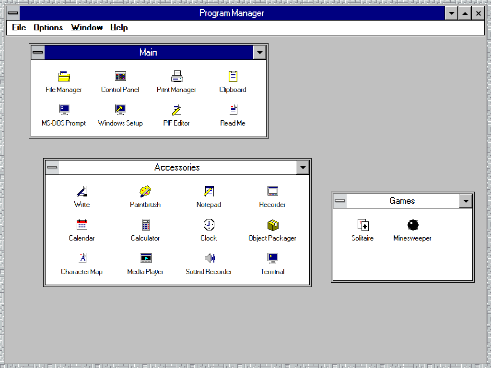

用本组件库完整复刻的 Windows 3.1 **Program Manager** 桌面：程序组、22 个可运行应用、
可拖动窗口、菜单、对话框与六套可切换配色——全部由 React 实现。

## 在线演示

**https://shinetaku.github.io/win31ui/** —— 每次推送 `main` 时由 GitHub Actions
自动从 `examples/desktop-demo` 构建并部署到 GitHub Pages。

## 交互动图

| 窗口拖动 / 最小化还原 | 文件管理器 |
|---|---|
|  | 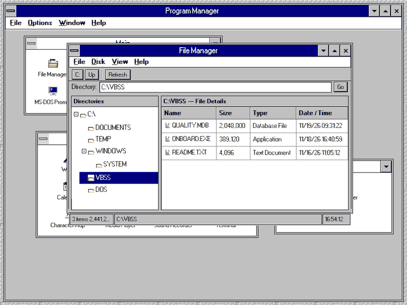 |

| 计算器 | 六套配色主题 |
|---|---|
| 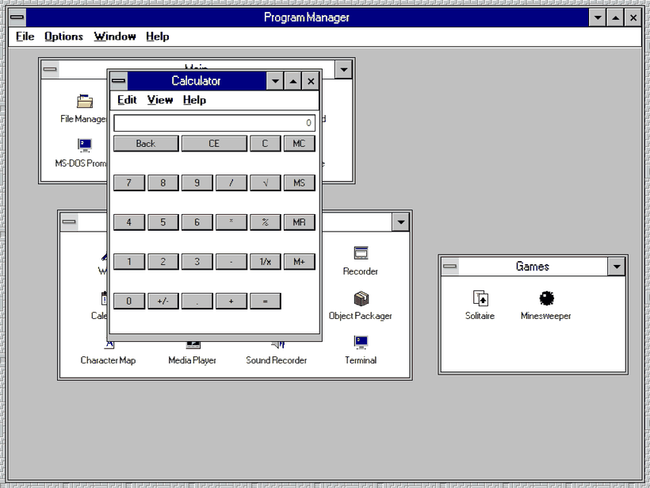 | 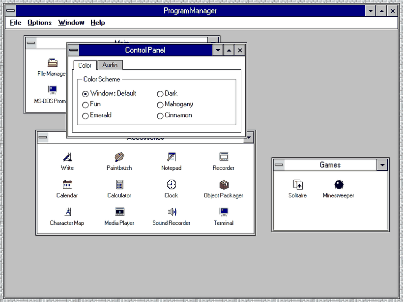 |

| 扫雷 |
|---|
| 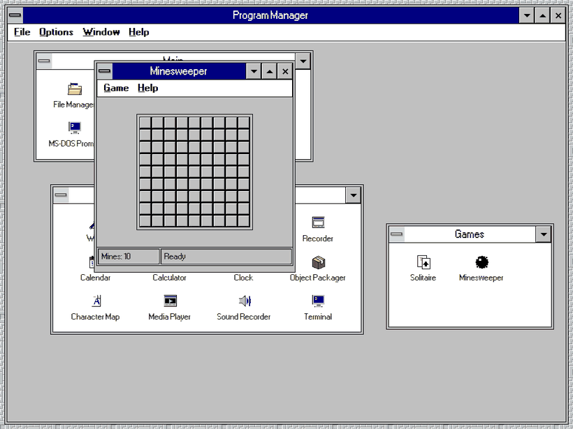 |

## 界面一览

| | |
|---|---|
|  | 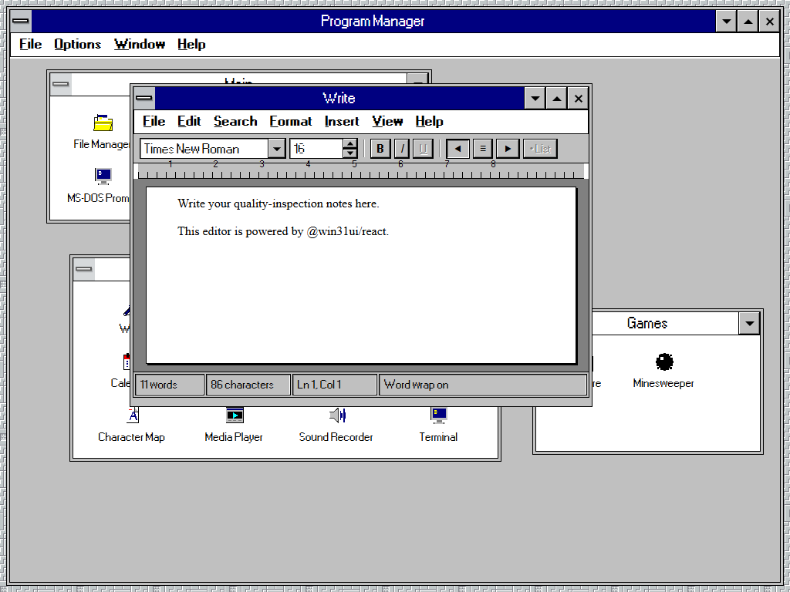 |
| 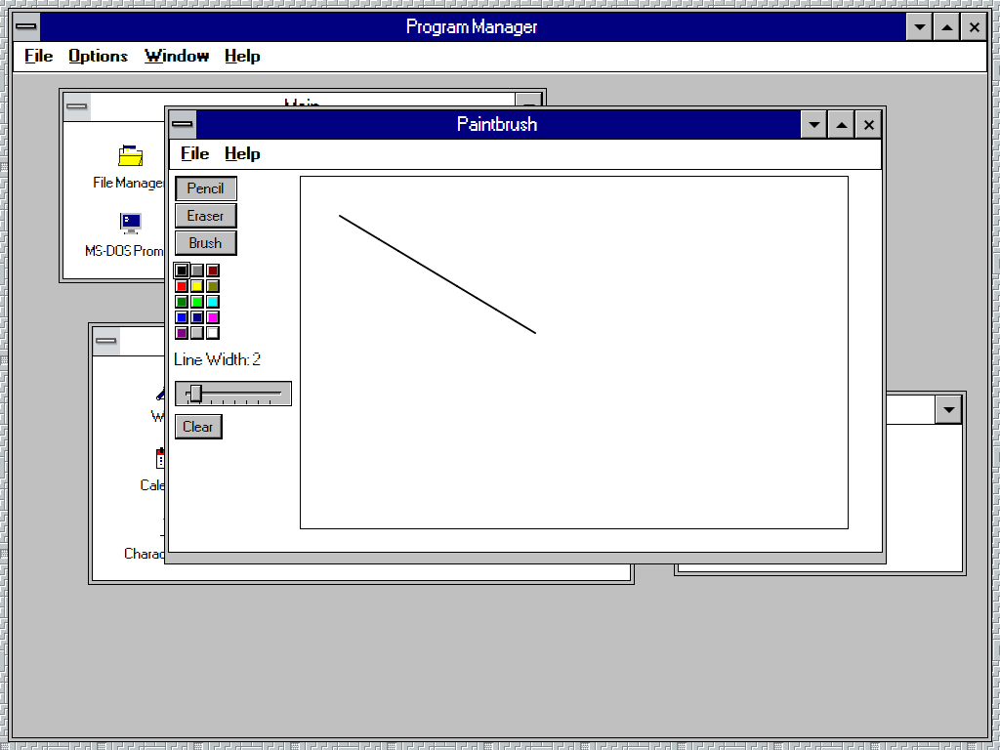 | 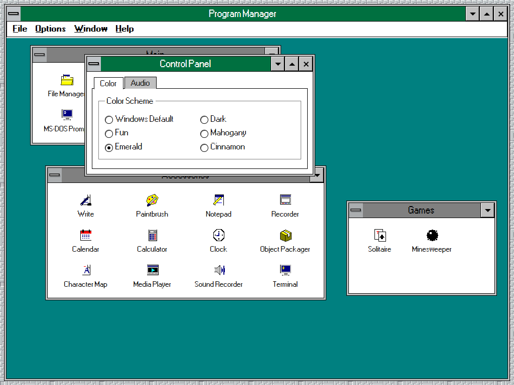 |
| 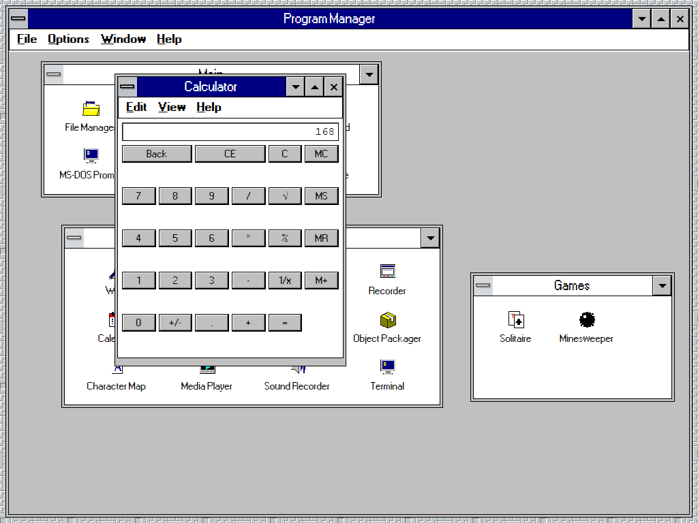 | 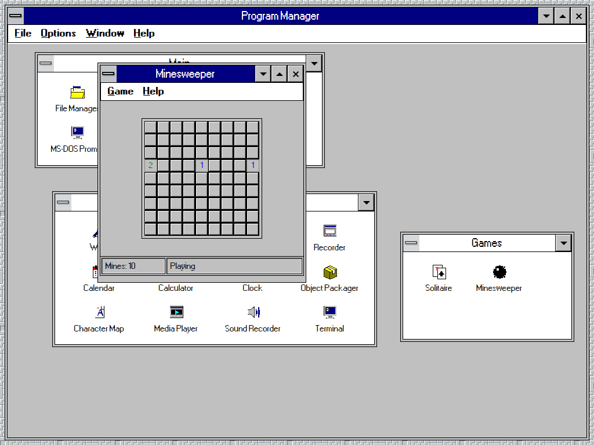 |
| 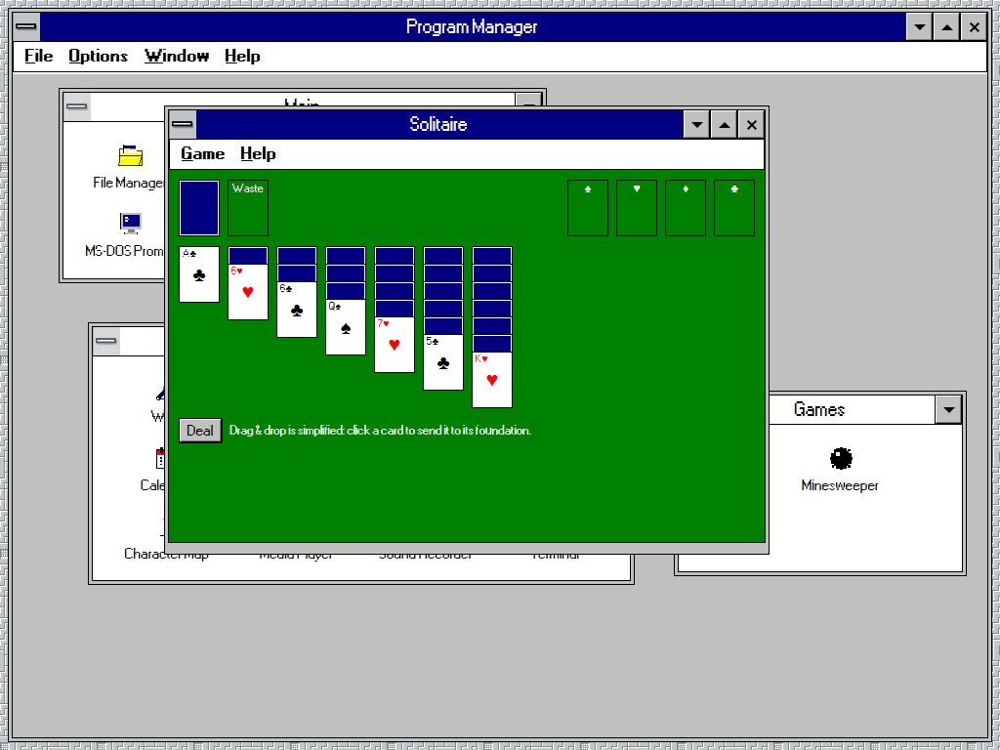 | 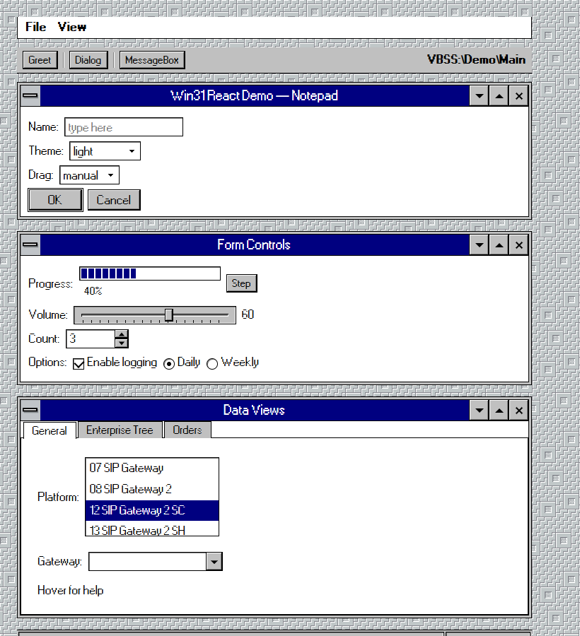 |

## 特点

- **原汁原味的 3.1 外观**——16 色、1px 黑框 + 2px 斜面、#000080 标题栏、
  MS Sans Serif 像素字体；无圆角、无投影、无渐变（设计语言提取自
  [hugo-win31](https://github.com/theletterf/hugo-win31)，MIT）。
- **六套主题**——整个桌面实时换肤：`light`（Windows 默认）、`dark`、`fun`、
  `mahogany`、`emerald`、`cinnamon`。
- **无障碍**——ARIA 菜单栏键盘模型（单一 Tab 停靠点、方向键）、可键盘排序的
  表头按钮（`aria-sort`）、原生 `<dialog>` 模态框、键盘驱动的滑块/微调/树/列表。
- **SSR 与桌面端就绪**——服务端可渲染、入口带 `'use client'`、四种窗口拖动
  模式（`none` / `manual` / `electron` / `tauri`）。
- **单一依赖**——样式、像素字体与位图资源都打包在 `@win31ui/react` 内。

## 安装

```bash
npm install @win31ui/react
```

```ts
import '@win31ui/react/win31.css'   // tokens、主题、字体与基础类
import '@win31ui/react/styles.css'  // 组件状态
import { Win31Window, Win31Button, Win31MenuBar } from '@win31ui/react'
```

```tsx
<Win31Window title="质检开户" dragMode="manual" bodyClassName="is-flush">
  <Win31MenuBar>{/* Win31Menu … */}</Win31MenuBar>
  <Win31Field label="企业："><Win31Input placeholder="ACME" /></Win31Field>
  <Win31Button isDefault>确定</Win31Button>
</Win31Window>
```

位图资源位于 `@win31ui/react/assets/*`。

## 组件

| 分组 | 组件 |
|---|---|
| 主题 | `Win31Provider`、`useWin31Theme`、`applyWin31Theme`——`<html>` 上的 `data-win31-theme` |
| 窗口 | `Win31Window`（dialog/maximized）、`Win31TitleBar`（系统菜单、最小化/最大化/关闭、四种 `dragMode`） |
| 菜单 | `Win31MenuBar`（单一 Tab 停靠点、方向键导航、悬停切换）、`Win31Menu`、`Win31MenuItem`、`Win31MenuLink`、`Win31MenuSeparator` |
| 导航 | `Win31Tabs`（ARIA tablist）、`Win31GroupBox` |
| 控件 | `Win31Button`、`Win31Input`、`Win31Textarea`、`Win31Field`、`Win31Checkbox`、`Win31Radio`、`Win31NumberField`、`Win31Slider`、`Win31ProgressBar`、`Win31ComboBox`、`Win31ListBox` |
| 数据 | `Win31Table<T>`（TanStack：可排序表头按钮、行选中）、`Win31Tree`（[+/−] 方框 caret、自定义图标）、`Win31List`（分组/缩进详情列表）、`Win31Calendar` |
| 反馈 | `Win31Dialog`（原生 `<dialog>`）、`Win31MessageBox`、`Win31Tooltip` |
| 工具条 | `Win31Toolbar`、`Win31ToolbarSeparator`、`Win31StatusBar`、`Win31StatusPane` |
| 桌面 | `Win31Desktop`、`Win31DesktopIcon` |

所有 props 类型均已导出；在编辑器中悬停组件即可查看 JSDoc。

## SSR（Next.js App Router）

```tsx
// app/layout.tsx
export default function RootLayout({ children }: { children: React.ReactNode }) {
  return (
    <html lang="zh-CN" data-win31-theme="light">
      <body>{children}</body>
    </html>
  )
}
```

见 [`examples/next-app`](./examples/next-app)：其 Playwright 套件会校验 SSR 标记与 hydration 零错误。

## Electron / Tauri

在 `Win31Window` / `Win31TitleBar` 上传 `dragMode="electron"`
（`-webkit-app-region: drag`）或 `dragMode="tauri"`（`data-tauri-drag-region`）。
Vite 示例同时充当共享渲染层——见 [desktop.zh-CN.md](./examples/vite-app/desktop.zh-CN.md)。

## 仓库结构

```
packages/win31-tokens/   设计令牌、主题、字体、位图（不单独发布）
packages/win31-react/    发布包——组件 + 内置 tokens
examples/desktop-demo/   Windows 3.1 Program Manager 复刻（在线演示）
examples/vite-app/       组件画廊 + Electron/Tauri 渲染层
examples/next-app/       SSR 验证（App Router）
e2e/                     三个示例的 Playwright 套件
docs/screenshots/        README 展示素材
scripts/                 截图/GIF 生成器、交互自测脚本
```

## 开发

```bash
npm install          # 安装 workspaces（本机 bun install 有 Windows EPERM 问题）
npm run build        # 构建 @win31ui/react（esm + cjs + d.ts + tokens）
npm run typecheck    # 全包严格 tsc
npm test             # 125 个 vitest 单元测试（jsdom）
npm run dev:desktop  # 桌面复刻 :5174
npm run dev:vite     # 组件画廊 :5173
npm run dev:next     # SSR 示例 :3000
```

## 测试

- **单元**——vitest + Testing Library，21 个文件 125 个用例
- **e2e**——Playwright 用系统 Edge 跑三个示例：
  `npm run test:e2e:vite`（14）、`npm run test:e2e:next`（8）、
  `npm run test:e2e:desktop`（15），含 SSR 标记校验、hydration 错误扫描与视觉快照
- **交互自测**——`python scripts/selftest.py` 驱动 20 条真实用户操作路径

## 致谢

- 设计语言与像素资源：[theletterf/hugo-win31](https://github.com/theletterf/hugo-win31)（MIT）
- 32×16 色应用图标：改自 [WieslawSoltes/Win31](https://github.com/WieslawSoltes/Win31)（MIT）

## 许可证

MIT —— 见 [LICENSE](./LICENSE)。
